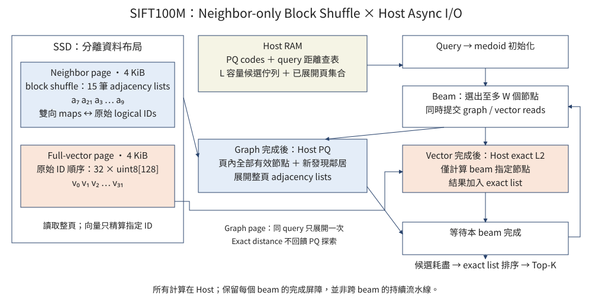

# SIFT100M：分離布局與 Host 非同步搜尋實驗



本實驗使用 `search_split_async`，保留原本 DiskANN 搜尋入口。距離計算全部在 Host 執行，目的是觀察非同步 SSD 讀取能與 PQ 圖探索重疊多少工作。

## 資料布局與 ID

Neighbor 使用現成的 **neighbor-only block shuffle**，每個 4 KiB page 最多放 15 筆 adjacency lists（每筆含 degree 與至多 64 個鄰居 ID）。`old_to_new` 將原始節點 ID 轉成實體 slot；`new_to_old` 從 slot 找回原始 ID。最後一頁僅處理有效 records。

Full vector 不 shuffle，維持原始 ID 順序。SIFT100M 為 128 維 uint8，一筆 128 bytes，因此每頁包含 32 筆向量。PQ codes、graph edges、ground truth 和回傳 IDs 都使用原始 logical IDs。

## 每個 beam 的執行流程

1. 從容量 L 的 PQ 候選佇列取出至多 W 個節點。
2. 映射到 neighbor pages，同 beam 合併重複頁，略過本 query 已展開的頁。同時為每個選出的節點提交 full-vector page read。
3. 依 graph 請求順序處理完成資料：頁內所有有效節點做 PQ，並展開每一筆 adjacency list；新發現的鄰居做 PQ 並嘗試進入候選佇列。已發現的頁內節點仍重算 PQ，但不重複插入。
4. 處理 vector 讀取，只精算該請求指定節點的 exact L2。即使整頁帶回 32 個向量，也不精算其他向量。不同請求若落在同一 vector page，目前仍各自讀取。
5. 本 beam 的向量請求全部完成後，才開始下一個 beam。候選耗盡後，排序 exact list 並回傳 Top-K。

讀過 graph page 的節點，之後仍可能被 beam 選中並要求其 full vector。Exact distance 不修改 PQ 探索或剪枝條件。這是整頁圖展開的實驗策略，與原始 DiskANN 的逐節點展開不同。

## 準備與執行

從 DiskANN_cpp 目錄執行。準備腳本以 symlink 重用既有 shuffled graph 與 maps，另外寫出約 12.8 GB 的原始順序向量檔。輸出目錄必須尚未存在。

```sh
python3 experiments/split_async/prepare_shuffled.py \
 --neighbor-prefix /home/emmanuel/projects/DiskANN_cpp/results/nbr_only_block_shuffle_sift100m_20261014/sift100m_nbr_block_shuffle \
 --base /home/emmanuel/projects/data/sift100m/base.100M.u8bin \
 --out /home/emmanuel/projects/data/sift100m_split_shuffled
cmake --build build --target search_split_async -j4
```

執行範例：L=120、beam=16、K=10、前 100 個 queries。

```sh
LAYOUT=/home/emmanuel/projects/data/sift100m_split_shuffled
INDEX=/home/emmanuel/projects/data/sift100m_diskann_indexes/sift100m_l2_R64_L100_pq0_default
MEDOID=$(python3 -c 'import json,sys;print(json.load(open(sys.argv[1]))["medoid"])' "$LAYOUT/layout.json")
build/apps/search_split_async "$LAYOUT/neighbors.bin" "$LAYOUT/vectors.bin" \
 "${INDEX}_pq_compressed.bin" "${INDEX}_pq_pivots.bin" \
 /home/emmanuel/projects/data/sift100m/bigann_query.u8bin \
 "$MEDOID" 120 16 10 100 results.csv \
 "$LAYOUT/old_to_new.bin" "$LAYOUT/new_to_old.bin"
```

Neighbor 檔有一頁 NBRONLY1 header，vector 檔沒有 header。請使用 `prepare_shuffled.py`；舊版 `prepare.py` 的 identity layout 不適用於目前搜尋入口。PQ 檔使用 default index，不能換成 full-node block shuffle 後的 PQ codes。

## 計時與目前限制

採單一 query thread、O_DIRECT 與 libaio；PQ codes 常駐 RAM，目前既有檔案為每節點 128 bytes。沒有跨 query 的 graph cache。所有計時為 Host wall time，包含 profiling 開銷。

| CSV 欄位 | 意義 |
|---|---|
| total_us | Query 總時間；含未單獨分類的配置、解析等成本 |
| pq_us / candidate_us / exact_us | PQ 查表與計分／候選維護／指定向量精算時間 |
| wait_us / submit_us | 主動等待完成事件／提交 I/O 的時間 |
| neighbor_reads / vector_reads | Host 端兩類 4 KiB 讀取請求數 |
| host_read_bytes | 請求的總讀取 bytes，不代表 NAND bytes |
| resident_pq_evaluations | 頁內節點的 PQ 計算次數 |
| pq_evaluations | PQ 計算次數，包含重算，排除初始化 medoid |
| result_ids | 原始 logical IDs，可對照 ground truth |

I/O 飛行期間可與 CPU 工作重疊，因此 wait_us 並非 SSD 服務時間或 NAND latency。裝置服務時間需另接 trace。已編譯，並以小型案例檢查逆序映射、部分填滿的最後一頁、整頁 PQ 與指定向量精算；尚未完成 SIFT100M recall 與效能量測。

## 一鍵執行 L=20、60、120，W=16

```bash
cd /home/emmanuel/projects/DiskANN_cpp
bash experiments/split_async/run_sift100m.sh
```

預設每組跑前 100 個 queries、K=10。腳本自動準備缺少的 layout，已有 layout 則檢查後重用；接著編譯並依序跑三組。終端顯示英文階段、向量複製與 query 進度，並把 log 和 CSV 放進新建的 results 子目錄。進度列印在每筆 query 計時之外，但正式效能分析仍應考量 profiling 的影響。

跑完整 10,000 個 queries：

```bash
QUERY_LIMIT=10000 bash experiments/split_async/run_sift100m.sh
```

若 layout 目錄存在但不完整，腳本會停止並保留檔案，不會自動覆寫。`run.log` 記錄全部階段，`L20_W16.csv`、`L60_W16.csv`、`L120_W16.csv` 是逐 query 結果。目前腳本尚未計算 recall。

## Block layer 與 Host 完成事件時間

先準備好 layout，再執行（kernel tracing 需要 sudo）：

```bash
BEAM_WIDTHS="8 16 32" QUERY_LIMIT=100 bash experiments/split_async/trace_sift100m.sh
```

只要 Host trace：

```bash
TRACE_IO=1 BEAM_WIDTHS="8 16 32" bash experiments/split_async/run_sift100m.sh
```

每組 CSV 旁新增 `.io.csv`，含 query、beam、request、kind、指定 node、檔案 offset、提交 syscall 前後、完成事件觀測、開始使用資料及等待區間的 nanosecond 時戳。neighbor 的 node 是 UINT32_MAX，請用 offset 與 map 判讀整頁；vector 的 node 才是指定精算節點。

Host 使用 CLOCK_MONOTONIC，trace-cmd 使用 mono。`completion_observed_ns` 緊接 io_getevents 回傳記錄，是「使用者空間取得完成事件」時間；即使該事件不是目前正在等的請求，也會記錄。`processing_start_ns` 是 wait 返回、開始使用資料前的邊界。提交時間是 syscall 前後的區間，不能把區間內某一點當作精確 kernel 接收時間。

`block.dat` / `block.txt` 保留 block request issue/complete、bio queue/complete。Block complete 是核心 block 層完成時間，不是硬體內部完成時間。trace 包含背景 I/O，不能以 completion 的 PID 篩選本程序（completion 可能在中斷或 worker 上）。利用 `.io.csv` 的種類、檔案 offset，以及 before/after FIEMAP 和 device/partition 資訊對應實體 sectors。若檔案在不同裝置、分割區、device mapper 或其他儲存堆疊，必須在同一層比較 sector 範圍。

**不能假設一筆 Host read 對應一筆 block request。** 合併、拆分、重複讀同一 vector page 都會造成對應歧義；有歧義的對應必須標記 unresolved，不能硬配最近時間。這版保留原始事件與映射資料，尚未自動算出可信的跨層重疊率。對應成功後，才能將 block complete 與 Host observed 相減，分析核心完成到 Host 收取的延遲；這段也包含核心完成傳遞與排程，不能全部歸因於 PQ。

每次分析必須檢查 LOST EVENTS、trace buffer overflow，以及檔案 extents 是否改變。trace 會增加開銷，請另跑未開 TRACE_IO 的效能對照。wrapper 預設使用既有 layout，記錄整個 sweep，因此包含載入 PQ 與 maps 的 I/O；分析請依 Host query 時間窗與資料檔案範圍篩選。

## 與原版 DiskANN 的計算路徑對齊

PQ 已改為直接呼叫原版 `aggregate_coords` 和 `pq_dist_lookup`，每筆 adjacency list 批次計分，然後才做 visited 過濾；resident 與其鄰居的插入順序保留。Visited 改用原版的 `tsl::robin_set<uint64_t>`，候選仍使用 `NeighborPriorityQueue`。Exact L2 使用 `get_distance_function<uint8_t>(Metric::L2)` 選出的原版距離函式；PQ scratch 和 exact query 使用對齊、跨 query 重用的緩衝區。

細粒度階段計時預設關閉。需要分解時間時使用 `PROFILE_HOST=1`；CSV 的 `profile_host=0` 表示 pq_us／candidate_us／exact_us／wait_us／submit_us 未量測，零值不代表沒有成本。`total_us` 一律量測；TRACE_IO 獨立控制逐請求 trace。PQ 次數現在包含已看過鄰居的批次計分，因此不能直接與舊版僅新發現鄰居計分的計數比較。

仍保留你指定的整頁 adjacency 展開、shuffled graph 與獨立 vector 位址、graph page 去重、async reads、指定節點精算及 beam 屏障。它們不是原版預設搜尋的等價重排；目前仍無 node cache、filter 和多 medoid 選擇，僅使用本資料的單 medoid。批次 I/O buffer 生命週期也仍屬實驗版。原版 search 入口未修改；不能把新版直接稱作「只改 layout 的原版 DiskANN」。先前 scalar／密集計時的效能結論須重新量測。


## 只做圖探索：隔離 full-vector 路徑成本

`SEARCH_MODE=baseline`（預設）保留原本搜尋；`SEARCH_MODE=traverse_only`
不開啟 vector 檔、不提交 vector I/O、不算 exact，也不做 exact 排序。
鄰居 page 的讀取、整頁展開、PQ 批次計分、候選與停止條件保持原本邏輯。
每輪仍等 graph 處理完成，但不再等 vector。原版 DiskANN 搜尋未改動。
腳本仍檢查完整 split layout，請使用既有資料。

```bash
cd /home/emmanuel/projects/DiskANN_cpp
SEARCH_MODE=baseline PROFILE_HOST=1 TRACE_IO=0 BEAM_WIDTHS="8 16 32" bash experiments/split_async/run_sift100m.sh
SEARCH_MODE=traverse_only PROFILE_HOST=1 TRACE_IO=0 BEAM_WIDTHS="8 16 32" bash experiments/split_async/run_sift100m.sh
```

英文進度與結果路徑會顯示模式。建議交錯重複兩模式，另以 `PROFILE_HOST=0`
測量較少計時干擾的總延遲。這些指令會執行各 100 queries、L=20/60/120。

新增 CSV 欄位：

- `search_mode`：模式。traverse_only 的 `result_ids` 留空，不能當成已完成 rerank 的 recall 結果。
- `thread_cpu_us`：以 CLOCK_THREAD_CPUTIME_ID 測量搜尋執行緒的 CPU 時間（含系統態），不含載入資料與輸出 CSV；兩模式皆啟用。
- `beam_count`、`selected_nodes`：探索輪數、選中展開節點數。搭配 neighbor_reads、pq_evaluations 比較工作量；計數相同仍不等於證明序列完全相同。
- `neighbor_wait_us`、`vector_wait_us`：分開累計兩類 io.wait 的牆鐘時間，包含 completion 處理；PROFILE_HOST=0 時為零。

比較平均 total_us、thread_cpu_us、neighbor_reads、vector_reads、host_read_bytes。
單執行緒忙碌比例用 sum(thread_cpu_us)/sum(total_us)，不是 1-wait_us/total_us。
CPU 時間相近但總時間下降時，忙碌比例可能提高，不能事先假定維持不變。
請求數與 bytes 是 Host 讀取量，不是 NAND 實際讀取量。
A/B 延遲差包含向量讀取、競爭、提交、buffer 與 exact 路徑的成本，不能直接視為 SSD offload 收益：
裝置端 exact 通常仍需讀取向量。traverse_only 不提供最終 exact 結果，僅為診斷對照。


## Host 獨立 L2 worker

```bash
SEARCH_MODE=host_worker PROFILE_HOST=1 TRACE_IO=0 BEAM_WIDTHS="8 16 32" bash experiments/split_async/run_sift100m.sh
```

`host_worker` 保留 baseline 的 exact 候選，使用常駐的另一個 thread、獨立 AIO context，
處理 vector reads 與原版 L2 kernel。主 thread 提交 graph reads 後傳送本輪節點，
不等本輪向量，繼續圖探索；query 結束時等待所有向量，再排序 exact 結果。
不合併 vector page，不改 PQ 或圖探索規則。原版 DiskANN 未修改。

`VECTOR_QD` 預設等於 W，可指定 1..512。worker 每批最多讀取 VECTOR_QD 筆，
處理完一批再取下一批，並非 completion-driven 持續補滿 queue 的實作。
待處理 ID 佇列不設上限；`worker_max_queue` 記錄等待佇列峰值，不含已取出的批次。
thread 與 AIO context 跨 queries 重用；首次 query 可能包含 worker 初始化尚未完成的等待。
沒有綁核，請記錄執行環境，重複交錯跑三種模式。

CSV 新欄位（時間單位 μs）：

- `traversal_us`：query 起點到圖探索完成，包含 query 前處理；baseline 也包含逐 beam vector 路徑，並非純 graph 時間。
- `tail_wait_us`：host_worker 探索結束後等待 worker 完成的時間，不包含最後排序。
- `thread_cpu_us`：主 thread CPU 時間；`worker_cpu_us`：worker 處理該 query 的 CPU 時間（含條件變數等待處理、I/O 系統呼叫，初始化除外）。
- `total_cpu_us`：兩個 thread CPU 時間相加。除以 total_us 是平均使用核心數，可能大於 1，不能稱單核心忙碌比例。
- `worker_submit_us`、`worker_wait_us`、`worker_exact_us`：worker 分項牆鐘時間；PROFILE_HOST=0 時為零。
- `vector_qd`：worker 的向量批次上限，其他模式為零。

原有 exact_us、wait_us、submit_us 與 vector_wait_us **只表示主 thread**，host_worker 的
vector 計時在 worker_* 欄位。兩 thread 時間互相重疊，不能加總後當作 query 延遲分解。
TRACE_IO=1 時輸出兩 thread 的 trace，worker trace 在 query 完成後合併，CSV 未按時間排序；
request 是批次內編號，不是全域唯一 ID。
比較 baseline 與 host_worker 的 result_ids、neighbor_reads、vector_reads、PQ evaluations
和 selected_nodes，確認相同工作與結果，再比較 total_us、tail_wait_us 與 total_cpu_us。
這是 Host 平行分工對照，沒有模擬 SSD 內部 NAND、buffer 或傳輸節省。

## 原始順序布局對照

`GRAPH_EXPANSION=node` 新增逐節點展開模式：每個選中的節點讀自己的 neighbor page，僅處理指定 adjacency，不計算 resident PQ、不合併或記住已讀 graph pages。未設定時仍採 `page`，保留上述整頁展開行為。CSV 新增 `graph_expansion` 欄位。

需要與原版多 medoid 搜尋對齊時，同時設定 `SEARCH_MEDOIDS` 與 `SEARCH_CENTROIDS`，指向原版的對應 `.bin` sidecars；每筆 query 會以原版 float L2 選最近的起點。未設定時仍使用命令列的單一 medoid。

SIFT100M baseline / identity neighbor-only / traditional greedy 三組對照見 [layout_ablation](../layout_ablation/README.md)。

## Traversal 後依 PQ 比例精算

`SEARCH_MODE=deferred RERANK_PERCENT=40` 在 traversal 結束後，對整段探索中被 beam 選中的節點去重、按 PQ distance / ID 排序，只讀前 40% 的 vectors，至少 K 筆（候選不足時取全部）。`RERANK_PERCENT=100` 是同時程的全候選控制組。CSV 新增 `rerank_percent`、`rerank_pool`、`rerank_selected`、`rerank_us`；`beam_count` 仍只計 graph beams，trace 的尾端 vector batches 另有遞增 beam IDs。

A/B/C/D/E-host 的完整執行腳本見 [abcd/README.md](../abcd/README.md)。E_host 只量 traversal，SSD 路徑成本為未知 X。
